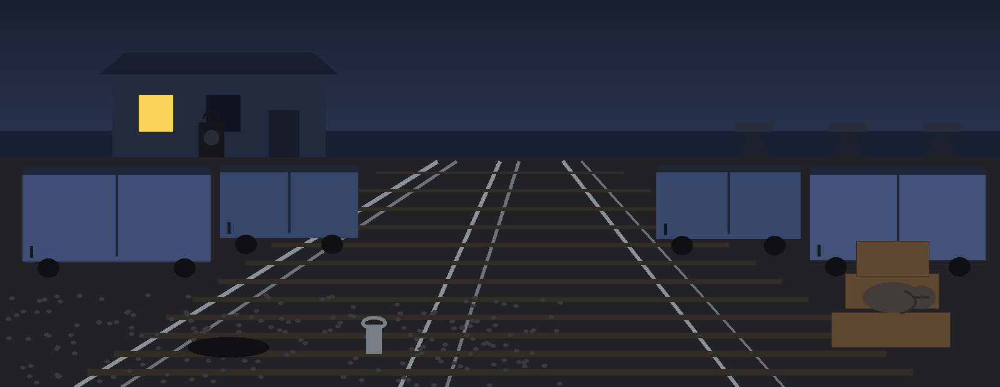
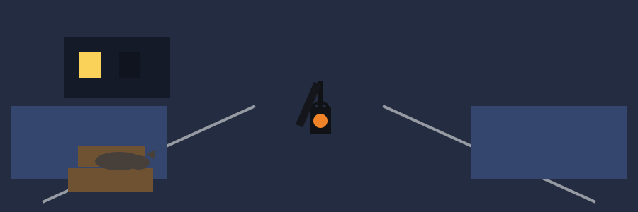

# crypto-nonce-analyzer

Title block: the name above is set as a wagon side plate, in Birthstone in sodium orange on a blue hour plate with a chalk band beneath it and a single lamp housing at the left of the first heading only.





# crypto-nonce-analyzer

Analyzes cryptographic nonces from text files (one nonce per line, hex encoded) for exact collisions and for incrementing pairs, which can indicate weak nonce generation.

Standard library only; there are no third party dependencies to install.


## Install

```bash
git clone https://github.com/ShadowGuard-AI/crypto-nonce-analyzer.git
cd crypto-nonce-analyzer
```


> Chalk mark: a hex line is strict: non empty, even in length, and every character a hex digit, upper or lower case.


> Chalk mark: one line that is not hex stops the whole job, while a line of the wrong length only earns a warning and a skip.


## Usage

```bash
python3 main.py nonces.txt --detect-collisions --detect-incrementing
python3 main.py a.txt b.txt --detect-collisions --output-file results.txt
```

The exit code is 0 for a completed analysis, 1 when a file cannot be read, a line is not valid hex, no valid nonces remain after length filtering, or the output file cannot be written, and 2 for invalid argument combinations.


> Chalk mark: step pairs can form across a file boundary, because every file is flattened into one combined list before either check runs.


## Parameters

- `nonces`: Positional, one or more files of hex encoded nonces, one per line.
- `--min-length`: Minimum nonce length in bytes to consider (default: 8).
- `--max-length`: Maximum nonce length in bytes to consider (default: 32). Nonces outside the range are skipped with a warning.
- `--detect-collisions`: Detect and report collisions among nonces.
- `--detect-incrementing`: Detect incrementing nonce patterns between consecutive nonces.
- `--output-file`: Optional file to write the analysis results to.


> Chalk mark: a job in which no check is flagged still ends at exit 0, printing a single line advising that no analysis options were selected.


## License

Licensed under the terms in LICENSE.


## Tally notes, entered at the close

The buttons of this re-skin read Count the Repeats, Check the Steps of One, File the Tally, and Show the Yard Rules. Its headings read Files Received in Order, Two Checks and No Others, Neighbours Only for Steps, and Judge the Job by Its Exit. The endings are tallied plainly once more: exit 0 for a completed job, exit 1 for a file or line that stops the job or a list left empty, and exit 2 for argument errors. The length controls stand at default 8 and default 32 bytes. One further fact is entered: the repository LICENSE file carries the MIT License, its holder line giving a pen name together with a single initial for the remaining name.
