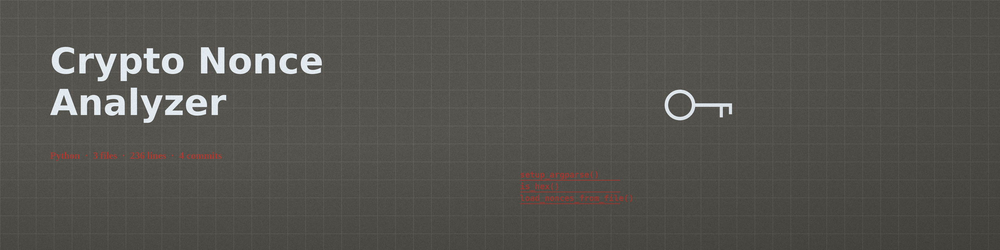

# crypto-nonce-analyzer

Analyzes cryptographic nonces from text files (one nonce per line, hex encoded) for exact collisions and for incrementing pairs, which can indicate weak nonce generation.

Standard library only; there are no third party dependencies to install.

## Install

```bash
git clone https://github.com/ShadowGuard-AI/crypto-nonce-analyzer.git
cd crypto-nonce-analyzer
```

## Usage

```bash
python3 main.py nonces.txt --detect-collisions --detect-incrementing
python3 main.py a.txt b.txt --detect-collisions --output-file results.txt
```

The exit code is 0 for a completed analysis, 1 when a file cannot be read, a line is not valid hex, no valid nonces remain after length filtering, or the output file cannot be written, and 2 for invalid argument combinations.

## Parameters

- `nonces`: Positional, one or more files of hex encoded nonces, one per line.
- `--min-length`: Minimum nonce length in bytes to consider (default: 8).
- `--max-length`: Maximum nonce length in bytes to consider (default: 32). Nonces outside the range are skipped with a warning.
- `--detect-collisions`: Detect and report collisions among nonces.
- `--detect-incrementing`: Detect incrementing nonce patterns between consecutive nonces.
- `--output-file`: Optional file to write the analysis results to.

## License

Licensed under the terms in LICENSE.
